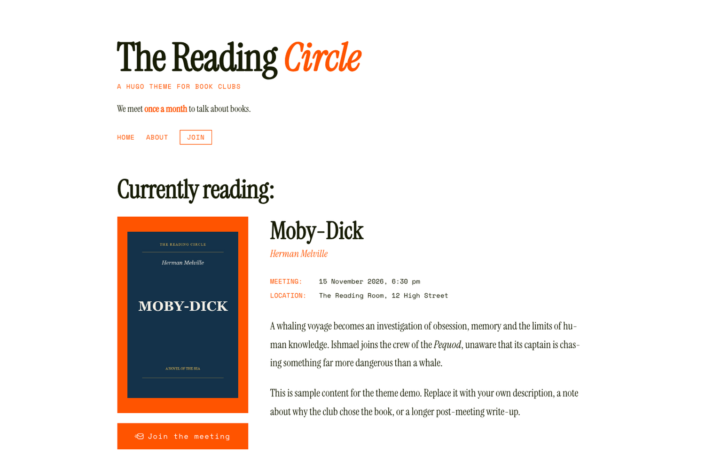

# Hugo Book Club — Hugo theme

A minimal, typography-only Hugo theme for a book club site. It ships a current reading section, an archive of past meetings, post-discussion notes, static pages, and a sign-up button.

## [Open demo website](https://offline.waw.pl)



## Requirements

- Hugo Extended `0.146.0` or newer.
- UI translations included: Polish (`pl`), English (`en`).

## Installation

### Option 1: Git submodule

```bash
git submodule add https://github.com/004822/hugo-book-club.git themes/hugo-book-club
```

If you publish the theme at a different URL, update `theme.toml` and this README.

### Option 2: Copy the directory

Copy `themes/hugo-book-club` into your site's `themes/` directory, then set in `hugo.toml`:

```toml
theme = 'hugo-book-club'
```

## Quickstart

The repository is both the theme and a demo site with three sample books in English.

```bash
git clone https://github.com/004822/hugo-book-club.git
cd hugo-book-club
hugo server -D
```

Open [http://localhost:1313](http://localhost:1313).

The demo content is marked `draft`, so `-D` is required. Do not set `theme` in the repository root: Hugo would try to load the theme from itself.

## Minimal configuration

```toml
baseURL = 'https://example.com/'
defaultContentLanguage = 'pl'

[params]
  title_italic = ''
  tagline = ''
  description = "Let's meet and talk about books."
  manifesto = 'We meet <span>once a month</span> to talk about books.'
  contact_email = 'club@example.com'
  webmanifest = 'site.webmanifest'
  default_og_image = 'images/og-default.jpg'
  archive_empty_text = 'Books we have discussed will appear here.'
  instagram_url = ''
  mastodon_url = ''
```

### Parameters

| Parameter                       | Description                                                      |
| ------------------------------- | ---------------------------------------------------------------- |
| `title_italic`                  | Part of the site title rendered in italics and the accent color. |
| `tagline`                       | Small subtitle under the club name.                              |
| `description`                   | Default description for SEO and Open Graph.                      |
| `manifesto`                     | Short sentence in the header. Accepts HTML, e.g. `<span>`.       |
| `contact_email`                 | Address the sign-up button points to.                            |
| `webmanifest`                   | Optional path to a PWA manifest.                                 |
| `default_og_image`              | Optional default Open Graph image.                               |
| `archive_empty_text`            | Text shown when there are no past meetings yet.                  |
| `instagram_url`, `mastodon_url` | Optional social profile URLs.                                    |

## Content structure

### Books

Put book files in `content/books/`, preferably in year subdirectories:

```text
content/books/2026/rift.md
```

Example front matter:

```yaml
---
title: "Rift"
author: "Jozef Karika"
date: 2026-10-01
edition: "October 2026"
meeting_date: "23.10.2026 (Friday), 6:30 pm"
meeting_location: "Literary Cafe, Warsaw"
cover: "covers/rift.jpg"
pages: 320
quote: "A line from the book or a reading motto."
recap: ""
tags:
  - Horror
discussion_topics:
  - "First topic"
  - "Second topic"
---

Book description, reason for choosing it, or a longer note.
```

Key fields:

- `date` — **date the entry was added**. The book with the latest date becomes the current reading; all older books go to the "Past meetings" archive.
- `meeting_date` — date of the meeting itself. It does not affect ordering.
- `recap` — post-meeting note. Shown in the archive and on the book page. Use a block scalar to keep paragraphs:

```yaml
recap: |
  First paragraph of the note.

  Second paragraph of the note.
```

The theme ignores `status` and `registration`. The "Sign up for the meeting" button appears only on the latest book.

### Pages

Put static pages in `content/pages/`:

```yaml
---
title: "About the club"
nav_title: "About"
weight: 1
highlight: false
---
```

- `weight` sets the menu order.
- `nav_title` overrides the label in navigation.
- `highlight: true` draws a border around the link.

## Static files

The theme includes fonts, social icons, default favicons, and a default Open Graph image. Your site should provide:

- `static/covers/` — book covers.
- Optionally, custom favicons and `static/images/og-default.jpg`.
- Optionally, `static/site.webmanifest`.

Files in your site's `static/` take precedence over the theme's, so you can override branding without modifying the theme.

## Translations

UI strings live in `i18n/pl.toml` and `i18n/en.toml`. To override them or add a language, create `i18n/<code>.toml` in your site.

## Appearance

Colors and fonts are CSS variables in `assets/css/style.css`:

```css
:root {
  --color-bg: #fff;
  --color-text: #171c04;
  --color-text-muted: #ff5400;
  --color-accent: #ff5400;
  --color-accent-soft: #ffe4d8;
  --font-serif: "Instrument Serif", Georgia, serif;
  --font-mono: "Space Mono", monospace;
  --max-width: 920px;
}
```

To restyle without editing the theme, copy `assets/css/style.css` to the same path in your site; Hugo uses the project file instead of the theme file.

## License

[MIT](LICENSE)
